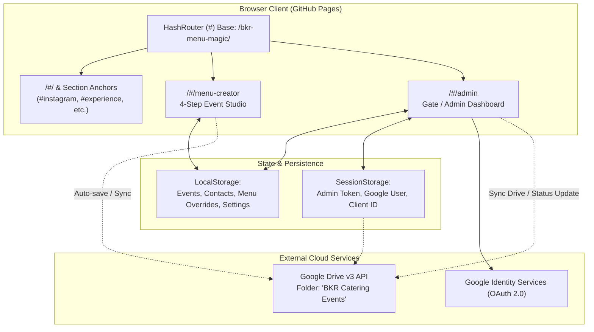
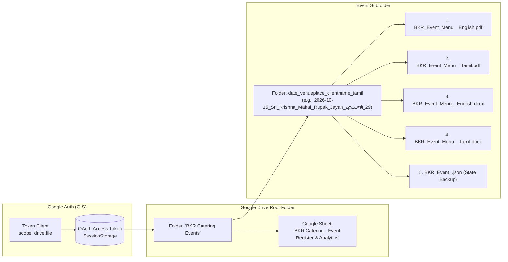

# CONTEXT.md — AI Agent & Developer Architecture Guide 🤖🧭

> **Comprehensive operational manual and architectural reference for any AI agent or engineer working on `bkr-menu-magic`.**

---

## 1. Executive Summary & Tech Stack

`bkr-menu-magic` is an enterprise-grade event menu planning and catering management platform built for **BKR Catering Services**. It is hosted as a static Single Page Application (SPA) on **GitHub Pages** with live **Google Cloud OAuth 2.0 (GIS)** and **Google Drive REST API v3** integrations.

### Key Technology Stack
| Category | Technology | Purpose |
|---|---|---|
| **Core Framework** | React 18 + TypeScript | UI component model & type safety |
| **Build Tooling** | Vite 5 | Fast HMR dev server & optimized production rollup |
| **Routing** | `react-router-dom` (HashRouter) | Hash-based client routing compatible with GitHub Pages |
| **Styling** | TailwindCSS + shadcn/ui | Utility styling with custom design tokens & high-contrast themes |
| **Icons** | `lucide-react` | Semantic icons across planner, dashboard, and landing pages |
| **Word Generation** | `docx` (v9.5) + `jszip` | Bilingual OpenXML `.docx` documents matching PDF styles |
| **PDF Generation** | `jspdf` + Canvas 2D | Multi-page `.pdf` generator with canvas-rendered Tamil font support |
| **Cloud Auth** | Google Identity Services (GIS) | Client-side OAuth 2.0 popup authentication |
| **Cloud Storage** | Google Drive REST API v3 | Subfolder organization, 4-document uploads, and Google Sheets |
| **Testing** | Playwright (14 tests) | Unit, integration, and end-to-end browser tests |

---

## 2. Core Architecture & Routing



### Routing Rules (CRITICAL)
- **Always use `HashRouter`**: GitHub Pages serves static files from a single `index.html`. Using standard HTML5 `BrowserRouter` causes `404 Not Found` when users refresh or directly load deep links like `/#/admin` or `/#instagram`.
- **Anchor Navigation**: Anchor links on the homepage (`/#instagram`, `/#how-it-works`, `/#experience`, `/#our-approach`, `/#contact`) are intercepted in [`Home.tsx`](file:///C:/Users/rupak/.gemini/antigravity/scratch/bkr-menu-magic/src/pages/Home.tsx) using `useEffect` with `requestAnimationFrame` to ensure smooth scroll without reloading.

---

## 3. Google Cloud & Drive Sync Pipeline



### The 4 Files & Subfolder Rule
Whenever syncing an event to Google Drive:
1. Locate or create root folder: `"BKR Catering Events"` (`getOrCreateBkrFolder`).
2. Generate subfolder name via `getEventSubfolderName(menu)`:
   Format: `${startDate}_${venueName}_${clientName}_${tamilSolarDate}`
   *(All spaces replaced with underscores, illegal filesystem characters stripped)*.
3. Locate or create the subfolder inside the root folder (`getOrCreateEventSubfolder`).
4. Generate and upload **four files**:
   - `BKR_Event_Menu_<Client>_English.pdf`
   - `BKR_Event_Menu_<Client>_Tamil.pdf`
   - `BKR_Event_Menu_<Client>_English.docx`
   - `BKR_Event_Menu_<Client>_Tamil.docx`
   - Plus `BKR_Event_<menu.id>.json` (for cross-device dashboard restoration).
5. Refresh the **Master Analytics Google Sheet** (`syncAnalyticsSpreadsheetToGoogleDrive`):
   - Converted automatically from structured CSV to a native Google Sheet.
   - Includes master rows for all events, status tracking, headcounts, dish counts, total revenue, and aggregate analytics metrics.

---

## 4. Document Styling & Color Synchronization

Both Word (`.docx`) and PDF (`.pdf`) are carefully synchronized to present identical traditional branding in both English and Tamil:

```
┌────────────────────────────────────────────────────────┐
│               CATERING SERVICES / கேட்டரிங் சேவைகள்     │
├──────────────────────────┬─────────────────────────────┤
│ DETAIL / விவரம்          │ INFORMATION / நிகழ்வு தகவல் │ (Fill: #5B3723, Text: #FFFFFF, Bold)
├──────────────────────────┼─────────────────────────────┤
│ NAME / பெயர்             │ Client Name                 │ (Left Fill: #F8F5F1, Left Text: #5B3723)
│ VENUE / இடம்             │ Venue Name                  │ (Right Fill: #FFFFFF, Right Text: #262626)
│ DATE / தேதி              │ 15-10-2026                  │ (Borders: #DCD5CD)
│ TAMIL DATE & DAY         │ புரட்டாசி 29 (வியாழன்)      │
│ PHONE NO / தொலைபேசி எண் │ +91 98765 43210             │
│ ADDRESS / முகவரி         │ Chennai                     │
│ MAPS / Google Maps       │ https://maps.app.goo.gl/... │
└──────────────────────────┴─────────────────────────────┘
```

### Color Palette Constants
- **`BRAND_BROWN`**: `#5B3723` (Warm traditional burgundy header & title color)
- **`PALE_BG`**: `#F8F5F1` (Cream table row & summary highlight)
- **`BORDER_COLOR`**: `#DCD5CD` (Soft border outline)
- **`INK`**: `#262626` (Crisp dark body text)
- **`WHITE`**: `#FFFFFF` (Card background & header text)

---

## 5. Configuration Reference: Where and How to Configure

| What to Configure | File to Modify | Variable / Setting | Notes |
|---|---|---|---|
| **Google Client ID** | [`src/services/googleAuthService.ts`](file:///C:/Users/rupak/.gemini/antigravity/scratch/bkr-menu-magic/src/services/googleAuthService.ts) | `DEFAULT_GOOGLE_CLIENT_ID` | Preconfigured with client ID `827617794538-...apps.googleusercontent.com` |
| **Admin Email Allowlist** | [`src/services/googleAuthService.ts`](file:///C:/Users/rupak/.gemini/antigravity/scratch/bkr-menu-magic/src/services/googleAuthService.ts) | `ALLOWED_ADMIN_EMAILS` | Array containing `bkrcaters@gmail.com`, `rupakjayan22@gmail.com`, etc. |
| **Google Drive Root Folder** | [`src/services/googleDriveService.ts`](file:///C:/Users/rupak/.gemini/antigravity/scratch/bkr-menu-magic/src/services/googleDriveService.ts) | `BKR_FOLDER_NAME` | Default: `"BKR Catering Events"` |
| **Default Drive Account** | [`src/services/googleDriveService.ts`](file:///C:/Users/rupak/.gemini/antigravity/scratch/bkr-menu-magic/src/services/googleDriveService.ts) | `DEFAULT_DRIVE_ACCOUNT` | Default: `"bkrcaters@gmail.com"` |
| **Kitchen Google Maps Link** | [`src/pages/Home.tsx`](file:///C:/Users/rupak/.gemini/antigravity/scratch/bkr-menu-magic/src/pages/Home.tsx) | `kitchenMapUrl` | Set to `https://maps.app.goo.gl/YXXNzhruoA9XZwn26` |
| **Business Default Settings** | [`src/services/localAdminService.ts`](file:///C:/Users/rupak/.gemini/antigravity/scratch/bkr-menu-magic/src/services/localAdminService.ts) | `DEFAULT_SETTINGS` | Default company name, terms and conditions in English & Tamil |
| **Menu Catalog & Pricing** | [`src/data/menuData.ts`](file:///C:/Users/rupak/.gemini/antigravity/scratch/bkr-menu-magic/src/data/menuData.ts) | `menuData` | Master dish catalog organized by category |

---

## 6. Testing Protocol (Playwright)

The project includes 14 automated tests running via Playwright on a local Vite server (port 8080):

### Running Tests
```bash
# Run complete test suite (all 14 tests)
npm test

# Run specific suite
npx playwright test tests/unit.test.ts
npx playwright test tests/integration.test.ts
npx playwright test tests/system.spec.ts

# Run with interactive UI
npx playwright test --ui
```

### Test Directory Map
1. **`tests/unit.test.ts`**:
   - `UT-01`: Tamil date engine calculation & transliteration.
   - `UT-02`: Graceful handling of invalid date strings.
   - `UT-03`: Calendar day arithmetic in IST timezone.
   - `UT-04`: Dish key generation & catalog normalization.
   - `UT-05`: Google Auth admin email allowlist validation.
   - `UT-06`: Google Drive subfolder naming format verification.
2. **`tests/integration.test.ts`**:
   - `IT-01`: Empty menu state financial calculations.
   - `IT-02`: Multi-session aggregator with quoted rates and transport charges.
   - `IT-03`: Google Client ID getter, setter, and fallback logic.
3. **`tests/system.spec.ts`**:
   - `ST-01`: Landing page integrity, image loading, and footer checks.
   - `ST-02`: `/#instagram` navigation without 404.
   - `ST-03`: Hash anchors (`#how-it-works`, `#experience`, etc.) integrity.
   - `ST-04`: Admin Access page, Google setup drawer, Demo sign-in, and dashboard transition.
   - `ST-05`: Dark and Light theme contrast verification for step banners.

---

## 7. Agent Guardrails & Do's / Don'ts

1. **NEVER change `HashRouter` to `BrowserRouter`**:
   - GitHub Pages serves the app at `https://rupakjayan.github.io/bkr-menu-magic/`.
   - Any path routing without hashes will fail with GitHub 404 errors on browser refresh.
2. **DO NOT remove or unbalance the 4 Drive files**:
   - The user workflow expects 4 files in every event subfolder: English PDF, Tamil PDF, English DOCX, and Tamil DOCX.
3. **DO NOT change the subfolder naming convention**:
   - Must strictly match `date_venueplace_clientname_tamil` using `getEventSubfolderName(menu)`.
4. **ALWAYS keep DOCX and PDF colors aligned**:
   - Any tweak to table headers or font styles in PDF must be mirrored in `docxExportService.ts`.
5. **ALWAYS verify with `npm test` and `npm run build`**:
   - Before committing any changes, run `npm test` to verify all 14 tests pass and `npm run build` to ensure the production rollup succeeds.
