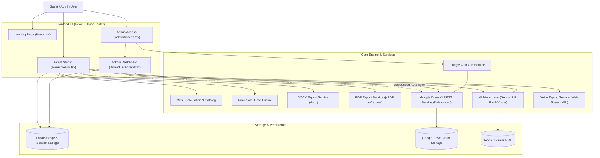
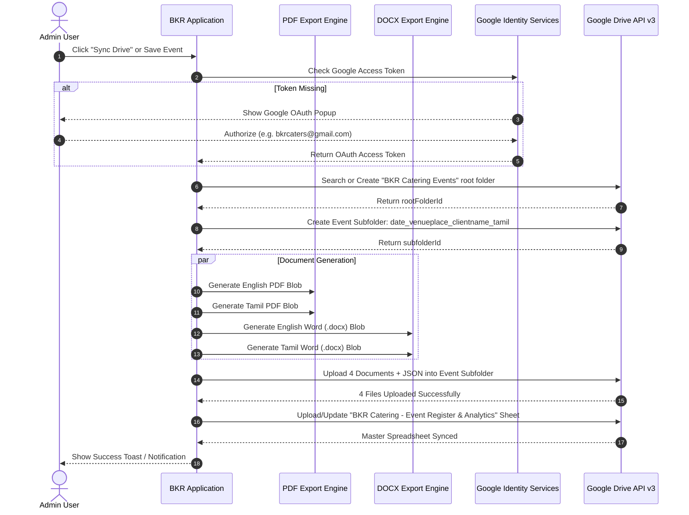

# BKR Menu Magic 🍲✨

[](https://www.typescriptlang.org/)
[](https://reactjs.org/)
[](https://vitejs.org/)
[](https://tailwindcss.com/)
[](https://playwright.dev/)
[](https://opensource.org/licenses/MIT)

> **Enterprise event catering, multi-session menu planning, bilingual document generation (English & Tamil), and Google Drive cloud synchronisation.**

---

## 🌟 Key Features

- **🌐 Bilingual by Design (English & Tamil)**: Complete support for English and Tamil (`தமிழ்`), including automated Tamil solar calendar dates (*Chithirai* through *Panguni*).
- **📋 4-Step Interactive Event Studio**:
  1. **Event Details**: Client info, venue location, dates, and Tamil solar calendar resolution.
  2. **Session Timeline**: Breakfast, Lunch, Dinner, High Tea with custom start/end times, guest headcounts, and quoted rates.
  3. **Curated Menu Selection**: Organized categorized dish catalog with vegetarian filters, custom items, and instant preview.
  4. **Review & Summary**: Live financial calculations, transport fees, grand totals, and instant downloads.
- **📄 Identical Word (.docx) & PDF (.pdf) Color Styling**:
  - Warm traditional burgundy headers (`#5B3723`) and cream label shading (`#F8F5F1`).
  - Crisp border lines (`#DCD5CD`) and clear typographic hierarchy.
  - Generates both English and Tamil copies in both formats.
- **☁️ Automated Google Drive Cloud Sync**:
  - Dedicated root folder: `BKR Catering Events`.
  - Structured event subfolders: `date_venueplace_clientname_tamil` *(e.g., `2026-10-15_Sri_Krishna_Mahal_Rupak_Jayan_புரட்டாசி_29`)*.
  - Saves **four documents** per event:
    1. English PDF (`.pdf`)
    2. Tamil PDF (`.pdf`)
    3. English Word (`.docx`)
    4. Tamil Word (`.docx`)
    *(Plus JSON state backup for cross-device loading)*.
  - **Master Google Sheet**: Automatically maintains `BKR Catering - Event Register & Analytics` inside Google Drive with live totals, guest counts, and revenue forecasts.
- **🔐 Google OAuth 2.0 (GIS) & Direct Admin Login**:
  - Seamless one-click Google Sign-in with the configured Web Client ID.
  - Authorized admin allowlist (6 Google Cloud Console test users):
    - `bkrcaters@gmail.com` (Default primary drive owner)
    - `imurugansea@gmail.com`
    - `raghavendrarbass@gmail.com`
    - `ragsrups22@gmail.com`
    - `rupak.jayanb@gmail.com`
    - `rupakjayan22@gmail.com`
  - Standalone PBKDF2 cryptographic browser password fallback for offline access.
- **📊 7-Module Admin Dashboard**:
  - **Overview**: Live statistics and upcoming events.
  - **Events**: Search, filter, status tracker (`Pending`, `Confirmed`, `Completed`, `Cancelled`), and one-click Drive sync.
  - **Calendar**: Interactive monthly view of bookings.
  - **Users & Contacts**: Team directory and staff management.
  - **Menu Management**: Catalog editor for dish names (EN & TA), pricing, and custom categories.
  - **Analytics**: Revenue, guest counts, and booking trends.
  - **Settings**: Business branding, default terms and conditions.
- **📸 AI Menu Lens (Handwritten Menu Digitizer)**:
  - Powered by **Google Gemini 1.5 Flash Multimodal Vision**.
  - Upload or capture photos of handwritten paper menus or printed catering sheets.
  - Automatically recognizes dishes in English and Tamil (`தமிழ்`), assigns catering categories, and provides an interactive verification table before adding to the catalog or active session.
- **🎙️ Bilingual Voice Typing & Continuous Auto-Add**:
  - Integrated speech recognition supporting Tamil (`ta-IN`) and English (`en-IN`).
  - **Single Search Mode**: Transcribes spoken dish names directly into the search bar.
  - **Continuous Menu Add Mode**: Hands-free voice curation. Spoken dishes are matched with a crisp confirmation tick beep (`playVoiceTickSound()`); repeated items are audibly alerted ("Already in menu") with double-pip sound (`playAlreadyAddedSound()`) and Web Speech Synthesis (`speakVoiceFeedback()`).
  - **Auto-Dictionary & Catalog Sync**: Unlisted dishes spoken via voice are automatically translated to Tamil, assigned a catering category, added to the session, and registered into the persistent bilingual dictionary both in parallel and post-session!
  - **Persistent Activity Tray & MERN Actions**: Displays all added dishes in a persistent status tray and review modal allowing coordinators to Create, Read, Update (inline name/category edit), and Delete items before proceeding.
- **🌐 Instant Tamil Culinary Translation & Transliteration**:
  - Sub-millisecond synchronous culinary translation engine (`tamilTranslationService.ts`).
  - Typing in English immediately generates authentic Tamil dish names, and typing in Tamil generates English names with automated category deduction.
- **🧭 Universal Day & Session Navigator**:
  - Direct top navigator bar enabling coordinators to jump between **any day and any session at any time**.
  - Default "Proceed to Next Session" progression button dynamically labeled with the upcoming session name.
- **🔍 Uncapped Search & Inline Bilingual Dish Creation**:
  - All matching catalog dishes displayed in a smooth scrollable dropdown without artificial limits.
  - Direct inline custom dish creation form inside search results with English, Tamil, and category inputs.
- **🔢 Precision Number Input Handling**:
  - Full backspace support allowing guest count, rate, and transport input fields to be cleared completely without snapping back to "1".
- **🎨 Accessible Light & Dark Themes (Theme Pack 164)**:
  - High-contrast traditional styling with Royal Burgundy (`#762934`), Warm Gold (`#d8b36d`), and Parchment surfaces. Zero unreadable text or light-on-light badges.
- **📍 Direct Google Maps Kitchen Link**: Quick navigation to BKR Catering's kitchen at [maps.app.goo.gl/YXXNzhruoA9XZwn26](https://maps.app.goo.gl/YXXNzhruoA9XZwn26).
- **📜 Formal Change Management**: Full audit trail of code modifications, architectural additions, and component matrices in [`CHANGE_MANAGEMENT.md`](CHANGE_MANAGEMENT.md).

---

## 🏗️ Architecture & Workflow

### 1. Overall System Architecture



---

### 2. Google Drive Cloud Sync & Document Generation Pipeline



---

## 📁 Repository Structure

```
bkr-menu-magic/
├── public/                     # Static assets, logos, and reference templates
│   ├── bkr-catering-reference.png
│   ├── bkr-logo.png
│   └── bkr-menu-template.docx
├── src/
│   ├── components/             # Reusable UI & wizard components
│   │   ├── steps/              # Event Studio Steps (1 to 4)
│   │   │   ├── EventDetailsStep.tsx
│   │   │   ├── SessionSelectionStep.tsx
│   │   │   ├── MenuSelectionStep.tsx
│   │   │   ├── ReviewStep.tsx
│   │   │   └── DocumentGenerationStep.tsx
│   │   ├── theme/              # ThemeToggle & dark mode logic
│   │   └── ui/                 # Radix UI + shadcn primitives
│   ├── pages/                  # Top-level view routes
│   │   ├── Home.tsx            # Main landing page
│   │   ├── MenuCreator.tsx     # 4-step event studio
│   │   ├── AdminAccess.tsx     # Admin authentication gate
│   │   ├── AdminDashboard.tsx  # 7-tab administration dashboard
│   │   └── NotFound.tsx        # 404 fallback page
│   ├── services/               # Core business services
│   │   ├── googleAuthService.ts    # Google Identity Services (GIS) OAuth
│   │   ├── googleDriveService.ts   # Google Drive v3 REST & subfolder sync
│   │   ├── docxExportService.ts    # Color-matched bilingual Word (.docx)
│   │   ├── pdfExportService.ts     # Canvas-assisted bilingual PDF (.pdf)
│   │   ├── menuCatalogService.ts   # Categorized dish management
│   │   ├── menuCalculationService.ts # Financial totals & headcount aggregations
│   │   ├── localAdminService.ts    # LocalStorage persistence & settings
│   │   └── adminAccessService.ts   # PBKDF2 local password authentication
│   ├── utils/                  # Date & string utility functions
│   │   ├── tamilDate.ts        # Tamil solar calendar computation
│   │   ├── istDate.ts          # Indian Standard Time (IST) formatting
│   │   └── assetUrl.ts         # GitHub Pages base path resolver
│   ├── types/                  # TypeScript interface definitions
│   │   └── menu.ts
│   ├── App.tsx                 # Root routes (HashRouter)
│   └── main.tsx                # App entrypoint
├── tests/                      # Automated Playwright test suite
│   ├── unit.test.ts            # Unit tests (UT-01 to UT-06)
│   ├── integration.test.ts     # Integration tests (IT-01 to IT-03)
│   └── system.spec.ts          # End-to-End System tests (ST-01 to ST-05)
├── CONTEXT.md                  # Comprehensive AI Agent & Architecture context
├── playwright.config.ts        # Playwright test configuration
├── vite.config.ts              # Vite configuration (base: /bkr-menu-magic/)
└── package.json
```

---

## ⚙️ Configuration & Environment

### Google OAuth 2.0 Web Client ID
The default Google OAuth Web Client ID is baked directly into [`src/services/googleAuthService.ts`](file:///C:/Users/rupak/.gemini/antigravity/scratch/bkr-menu-magic/src/services/googleAuthService.ts):
```ts
export const DEFAULT_GOOGLE_CLIENT_ID = "827617794538-iuu24eotjtmafui7fni969rk6l5n50vv.apps.googleusercontent.com";
```
You can also override this per-environment:
1. Via `.env.local`:
   ```env
   VITE_GOOGLE_CLIENT_ID=your-client-id.apps.googleusercontent.com
   ```
2. In the browser UI on `/admin` by clicking **Edit ID** in the Google setup drawer.

### Authorized Administrator Emails
Configured in [`src/services/googleAuthService.ts`](file:///C:/Users/rupak/.gemini/antigravity/scratch/bkr-menu-magic/src/services/googleAuthService.ts):
```ts
export const ALLOWED_ADMIN_EMAILS = [
  "bkrcaters@gmail.com",       // Primary owner
  "imurugansea@gmail.com",
  "raghavendrarbass@gmail.com",
  "ragsrups22@gmail.com",
  "rupak.jayanb@gmail.com",
  "rupakjayan22@gmail.com",
] as const;
```

---

## 🚀 Getting Started

### Prerequisites
- Node.js (v18 or higher recommended)
- npm or pnpm

### Installation
```bash
# Clone the repository
git clone https://github.com/RupakJayan/bkr-menu-magic.git

# Navigate into the project directory
cd bkr-menu-magic

# Install dependencies
npm install
```

### Local Development
```bash
npm run dev
```
Open [http://localhost:5173/bkr-menu-magic/](http://localhost:5173/bkr-menu-magic/) in your browser.

### Building for Production
```bash
npm run build
```
Production assets are output to `dist/`.

---

## 🧪 Testing

The repository includes a comprehensive Playwright test suite with **17 automated tests** covering Unit, Integration, and System/E2E levels:

```bash
# Run all tests headlessly
npm test

# Run tests in UI mode
npx playwright test --ui

# Run a specific test group
npx playwright test tests/unit.test.ts
```

| Test ID | Test Category | Description |
|---|---|---|
| **UT-01** | Unit | Tamil date calculation returns valid Tamil solar date & English transliteration |
| **UT-02** | Unit | Tamil date gracefully handles invalid inputs without crashing |
| **UT-03** | Unit | IST Date utilities compute accurate calendar day differences |
| **UT-04** | Unit | Menu Catalog builds, deduplicates, and normalizes dish keys |
| **UT-05** | Unit | Google Auth Email Allowlist validates administrator addresses |
| **UT-06** | Unit | Google Drive subfolder naming follows `date_venueplace_clientname_tamil` |
| **UT-07** | Unit | Instant Tamil culinary translation matches common catering dishes |
| **UT-08** | Unit | Category deduction guesses appropriate catering category from keywords |
| **IT-01** | Integration | Empty menu creation integrates with financial aggregator |
| **IT-02** | Integration | Multi-session calculations aggregate quoted rates & transport fees |
| **IT-03** | Integration | Google Client ID getter and setter integration with fallbacks |
| **ST-01** | System / E2E | Home page loads valid assets, no 404s, and verified footer |
| **ST-02** | System / E2E | Navigating to `/#instagram` smoothly scrolls without 404 |
| **ST-03** | System / E2E | Section hashes (`#how-it-works`, `#experience`, etc.) never 404 |
| **ST-04** | System / E2E | Admin Access page provides Google sign-in and dashboard access |
| **ST-05** | System / E2E | Menu Creator step banner has high contrast in Light and Dark modes |
| **ST-06** | System / E2E | Day/Session Navigator, Instant Tamil Translation, and Session MERN Dialog |
| **UT-09** | Unit | Culinary dictionary auto-registration and voice alias matching |

---

## 🚢 Deployment

The project is hosted on GitHub Pages:
**[https://rupakjayan.github.io/bkr-menu-magic/](https://rupakjayan.github.io/bkr-menu-magic/)**

Every push to the `main` branch automatically triggers the GitHub Actions workflow to build and deploy the updated application.

---

## 📄 License

This project is licensed under the MIT License.
